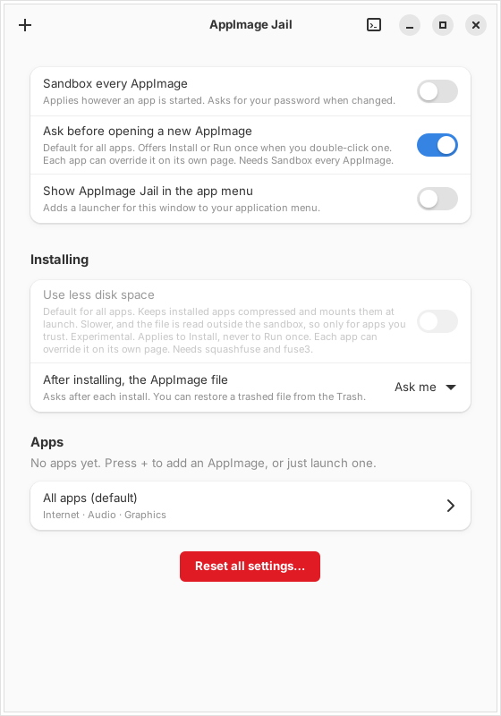

# ajail

Run AppImages in a [bubblewrap](https://github.com/containers/bubblewrap) sandbox. Each app gets a private home and its own permissions.

- `ajail`: launcher and CLI
- `ajail-gui`: GTK4 + libadwaita permission editor and installer
- `make-selftest`: builds a test AppImage that reports what the sandbox exposes



## Install

```bash
sudo dnf install bubblewrap squashfs-tools xdg-dbus-proxy libnotify python3-gobject gtk4 libadwaita   # Fedora; Debian, Ubuntu and Arch use the same names
sudo install -m 755 -o root -g root ajail ajail-gui /usr/local/bin/
ajail check      # lists what is missing, with the install command for your distro
ajail on         # optional: send every AppImage through ajail (asks for your password)
```

`ajail` must be a root-owned `/usr/local/bin/ajail`. Optional extras:

```bash
sudo install -Dm644 ajail.1 /usr/local/share/man/man1/ajail.1
ajail desktop --install-menu     # ajail-gui in the app menu; --remove-menu undoes it
sudo install -Dm644 completions/ajail.bash /usr/local/share/bash-completion/completions/ajail
sudo install -Dm644 completions/_ajail /usr/local/share/zsh/site-functions/_ajail
sudo install -Dm644 completions/ajail.fish /usr/local/share/fish/vendor_completions.d/ajail.fish
```

**Required:** Linux, Wayland (X11 is a per-app option, and Wayland can be turned off per app), Python 3, `bubblewrap`, `squashfs-tools`.
**Optional:** `xdg-dbus-proxy` (notifications, portals, `tray`, `mpris`, `a11y`, `gnome_shell`, `kde`, `bluetooth`, `battery`, `avahi`), `passt` (`net_private`), `squashfuse` + `fuse3` (compressed installs), `systemd --user` (resource limits), `notify-send` (failure popups).

## Usage

With `ajail on`, double-click an AppImage and choose **Install** (unpack once, add to the app menu, keep data on update) or **Run once** (unpack in the sandbox, delete on exit).

Terminal launches never prompt. Only type 2 AppImages work, and ajail refuses to run as root. The app name is the file name minus version and architecture (`Foo-1.2.3-x86_64.AppImage` is `Foo`).

```bash
ajail FILE.AppImage [args]    # open; prompts when double-clicked
ajail install FILE            # unpack and add to the app menu
ajail run NAME [args]         # run an installed app
ajail list | stop NAME
ajail uninstall NAME [--purge]
ajail preview [NAME]          # print the bwrap command
ajail on | off | status | check
```

All commands and options: `ajail help` or `man ajail`.

**Compressed installs (experimental):** off by default; needs `squashfuse`, `fuse3` and `/dev/fuse`. Keeps the AppImage as-is and mounts it at each launch: smaller on disk, slower to start. `squashfuse` reads the image outside the sandbox, so use it only for apps you trust.

## What the sandbox does

- Only `/usr` and a few `/etc` files are visible; the environment is rebuilt. Your `$HOME` is hidden except for shared folders. Each app's home is `~/.appimage-homes/NAME`.
- Unpacking runs in a separate sandbox with no network and no home.
- A seccomp blocklist denies `bpf`, `perf_event_open`, `kexec_load` and similar calls.
- `socket()` works only for unix, inet, inet6 and netlink sockets; `AF_ALG`, `AF_VSOCK`, `AF_PACKET` and the rest answer `EPERM`. 32-bit apps fail by default. `allow_32bit=1` (`--allow-32bit` for one run) lets 32-bit x86 apps run on x86_64 under the same lists, with a warning, because `socketcall()` (how 32-bit libcs reach `socket()`, `connect()`, `send()`...) hides its arguments in memory, so a filter can't check them: through it, the `socket()` family allowlist does not apply to 32-bit apps. If a 32-bit app fails while it is off, ajail says so in its message and in the log. Other 32-bit ABIs are always refused.
- Notifications and portals go through `xdg-dbus-proxy`, which allows only the permitted calls. The proxy tells the portals which app it serves, so the file chooser hands the app only the files you pick, through a folder of its own.
- The private home is tied to the app's `Name=`. A different app with the same file name is refused.

## Permissions

Plain `key=value` files: `~/.config/ajail/default.conf` (all apps) and `~/.config/ajail/apps/NAME.conf` (one app, overrides the default). Edit them in `ajail-gui`. Every key, default and list syntax is in `man ajail`. Keys whose effect isn't obvious:

| Key | Note |
| --- | --- |
| `net_private` | With `net`: internet but not services on this computer, via `pasta`. Your LAN stays reachable. |
| `gpu_render_only` | With `gpu`: only `/dev/dri/renderD*`, not the `card*` devices. |
| `wayland` | Wayland socket (default on). Where the compositor supports security contexts (`wp_security_context_v1`: Sway, Hyprland, KDE Plasma and others, not GNOME's Mutter as of version 51) the app gets a restricted socket, without screen capture or input injection; elsewhere it gets the full socket. Turn off for an app that runs on `x11` alone or needs no window. |
| `wayland_strict` | With `wayland`: never fall back to the full socket; if a restricted one can't be made, the app gets no Wayland. Not set anywhere means automatic: on where the compositor supports security contexts, off where it doesn't (so apps still start). Greyed out in `ajail-gui` on a desktop that can't. |
| `gtk_portal` | `auto` (default), `1` or `0`. With `portals`: tell GTK apps to use the file chooser portal (`GTK_USE_PORTAL=1`). `auto` does, except when your desktop's cursor size is 0, which crashes GTK (logged once). `1` and `0` force it for an app. Qt is not affected. |
| `x11` | X11 socket, in addition to Wayland. Weaker isolation. |
| `ssh_agent` | Your SSH agent. The app can sign as you. |
| `single_instance` | One private folder per app, shared by its sandboxes, with `TMPDIR` pointing at it, so a second launch finds the first (Chrome's singleton socket: opening a file in the running browser). `/tmp` stays private. |
| `a11y` | A screen reader (Orca) can read the app, through a filtered accessibility bus (needs `xdg-dbus-proxy`). The app can publish its own widgets and ask who is listening, nothing else, so it can't read other apps or send keys and clicks. Works without `portals`. |
| `gnome_shell` | The browser's GNOME Shell connector can list and install extensions, through the filtered session bus (needs `xdg-dbus-proxy`). Only `org.gnome.Shell.Extensions` at `/org/gnome/Shell` is reachable (the Shell asks you before installing); `Eval` stays closed. Works without `portals`. |
| `gnome_shell_manage` | With `gnome_shell`: also enable, disable and uninstall extensions. |
| `kde` | The browser's Plasma integration works: downloads show as Plasma jobs, KRunner finds tabs and history, media controls, keep awake while downloading, through the filtered session bus (needs `xdg-dbus-proxy`). Per-method rules only; KDE Connect stays closed. Works without `portals`. |
| `bluetooth` | The app can use Bluetooth (Web Bluetooth in Chrome), through a filtered copy of the system bus that lets through only `org.bluez` (needs `xdg-dbus-proxy`). It reaches nearby devices even with `net=0`. |
| `battery` | The app can read the battery level and power state (the browser's battery API): only `org.freedesktop.UPower` on the filtered system bus (needs `xdg-dbus-proxy`). |
| `avahi` | The app can find services on your local network by name (printers, Cast devices): only `org.freedesktop.Avahi` on the filtered system bus (needs `xdg-dbus-proxy`). It lists what is on your network. |
| `privacy` | Minimal `/etc/passwd`, `/etc/group`, `/etc/hosts`; hostname `ajail`; the `Account` portal (your real name) is blocked. |

```ini
allow=/home/me/Projects          # read & write
allow_ro=/media/me/usb/photos    # read-only
xdg=download                     # also documents, pictures, music, videos, desktop; :ro or :none
share_dirs=download,music        # default: download,documents,pictures,music,videos; empty = none
args=--profile work              # launch arguments, split like a shell would, put before the ones you type
env=MY_VAR=value
talk=org.example.Service         # extra D-Bus name
portal=Secret                    # turn on a portal that is off by default; portal=-Location turns one off
```

Files you open with an app ("Open with", a path argument) and `portals=1` with PyGObject: the app gets a read-only copy through the Documents portal, as Flatpak does, instead of a shared path. Files inside a folder you already share, and folders, are passed on as before.

Per-app folders: for each of Downloads, Documents, Pictures, Music and Videos that is set in `~/.config/user-dirs.dirs` and exists, `<folder>/ajail/NAME` is mounted over the same folder in the app's home (`~/Downloads/ajail/firefox` is `~/Downloads` for firefox), so the app sees only its own files there. `share_dirs=` picks some, or none when empty. What the app's home already holds in those folders is moved over on first use, never overwriting. ajail makes the folders with mode 0700 and never deletes them. If `ajail` or `ajail/NAME` is a link, ajail warns and that folder stays in the app's home. `xdg=` for the same folder shares the whole folder instead, and `tmp_home=1` ignores `share_dirs`.

Launch arguments: `args=--profile work` in an app's settings file (or `default.conf`) adds those arguments, split like a shell would, before the ones you type (`ajail-gui` has a gear button for it on each app's page). An app's `args` replaces the default's; an empty `args=` cancels it. Quote an argument that contains spaces. A `#` that starts a word begins a comment. Unlike a file you open with the app, a path in `args` is not shared: use `allow=` for that.

Back up or move settings with `ajail export -o FILE` and `ajail import FILE` (`--force` replaces settings that differ); `ajail-gui` has the same buttons. The export holds the permission files and the choices `ajail-gui` remembers (Ask before opening, Use less disk space, what to do with the AppImage after installing); it leaves out app data, installed apps, Sandbox every AppImage and the app menu entry.

### Defaults that favor compatibility

| Key | Default | What you give up | Stricter |
| --- | --- | --- | --- |
| `harden` | 0 | `io_uring_*`, `userfaultfd`, `process_vm_*`, `kcmp`, `pidfd_getfd` and the new mount calls (`fsopen`, `move_mount` and friends) stay available. | `harden=1`; may break apps, check the Log page |

`userns` is off by default, which needs bubblewrap 0.8+. Electron and Chromium apps need `userns=1` to make their own sandbox.

Also open on purpose: `net=1`, `sound=1` (includes the microphone), `gpu=1`, `portals=1` with screenshot and screencast (the desktop still asks), `theme=1`.

For an app you don't trust:

```ini
harden=1
net=0
sound=0
```

### Compatibility environment

With `compat_env` set to 1 (or `--compat-env` for one run) ajail copies these variables from your session, only if set, because the sandbox starts with an empty environment:

- `WGPU_BACKEND`, `WGPU_ADAPTER_NAME`, `WGPU_POWER_PREF`, `ICED_BACKEND`, `LIBGL_ALWAYS_SOFTWARE`, `LIBGL_DRI3_DISABLE`, `VK_ICD_FILENAMES`, `VK_DRIVER_FILES`, `__GLX_VENDOR_LIBRARY_NAME`, `__NV_PRIME_RENDER_OFFLOAD`, `DRI_PRIME`, `SDL_VIDEODRIVER`, `SDL_AUDIODRIVER`, `QT_QPA_PLATFORM`, `QT_QPA_PLATFORMTHEME`, `QT_SCALE_FACTOR`, `GDK_BACKEND`, `GDK_SCALE`, `MOZ_ENABLE_WAYLAND`
- Any name starting with `MESA_` or `RADV_`.

Nothing else is passed: not `PATH`, tokens, keys, `SSH_AUTH_SOCK` or `DBUS_*`. `ajail preview` shows what is passed.

### Extra portals

With `portals=1`, `Location`, `GlobalShortcuts`, `Usb`, `Clipboard`, `FileTransfer`, `Wallpaper` and `Secret` are on, because the desktop shows its own prompt where one is needed and each rule opens only that portal's interface (`Wallpaper` can only change the wallpaper); `portal=-NAME` turns one off (in `default.conf` or an app file). The far-reaching ones, `RemoteDesktop`, `InputCapture`, `DynamicLauncher` and `Background`, stay blocked unless enabled with `portal=NAME`. `Usb` lets an app ask for a USB device; `Clipboard` only works together with `RemoteDesktop` or `InputCapture`; `FileTransfer` lets an app receive files you drag in from other programs, and opens only that one interface of the Documents portal. `RemoteDesktop` and `InputCapture` can control or capture your keyboard and mouse; `Secret` gives the app one secret of its own, unique to it and not your keyring, which Chrome and Electron need to keep their saved logins; `Background` can register an autostart that runs outside the sandbox.

## Self-test

```bash
./make-selftest && ajail ./ajail-selftest.AppImage
```

Prints what the sandbox exposes and saves `selftest-report.txt` in the app's private home. Opt-in portals should read `blocked`; `EXPOSED` means one is reachable without being enabled.

## Development

`ajail` and `ajail-gui` are generated from `src/` and `src/gui/`. Edit the fragments, run `./build.py`, commit the result; never edit the generated files. Layering and review order: [src/README.md](src/README.md).

Checks (same as CI):

```bash
python3 tests/test_build.py                                 # generated files are current, layer rule holds
python3 -m pyflakes ajail ajail-gui build.py make-selftest tests/test_*.py
for t in tests/test_*.py; do python3 $t; done                 # test_hostile.py needs bubblewrap and squashfs-tools, run as a normal user
```

## Files

- Settings: `~/.config/ajail/`
- Private homes: `~/.appimage-homes/NAME`
- Installed apps: `~/.local/share/ajail/apps/NAME/`
- Log: `~/.local/state/ajail/ajail.log`

A notification that opens the app's log appears when an app exits with an error within 10 seconds, when it crashes (segmentation fault, abort and similar) at any time, and, for apps started without a terminal, when it exits with an error later.

## Limitations

ajail is a convenience layer over bubblewrap, not a security guarantee.

- `net` gives the app your network. `net_private` hides this computer's services, not your LAN or the internet.
- Without compositor support for security contexts (GNOME today) an app on Wayland gets the full socket. Set `wayland_strict=1` to give it none, or run the self-test (see above) to see what your compositor exposes.
- `x11`, `ssh_agent`, `input`, broad folder shares and the `RemoteDesktop`, `InputCapture` and `Background` portals weaken isolation.
- Compressed installs read the image outside the sandbox.
- Resource limits protect your session, not your privacy.

Check the result with the self-test or `ajail preview NAME`.

## License

GPL-3.0-or-later. See [LICENSE](LICENSE).
