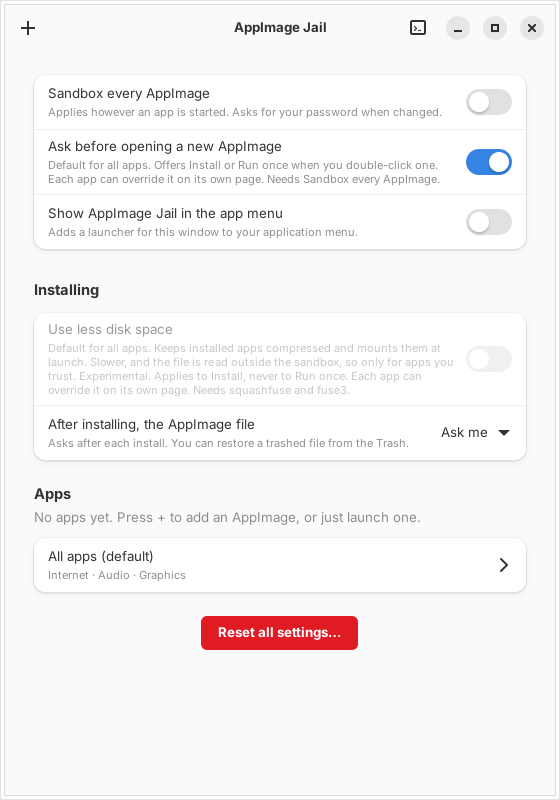

# ajail

Run AppImages in a [bubblewrap](https://github.com/containers/bubblewrap) sandbox. Each app gets a private home and its own permissions.

- `ajail`: launcher and CLI
- `ajail-gui`: GTK4 + libadwaita permission editor and installer
- `make-selftest`: builds a test AppImage that reports what the sandbox exposes



## Install

```bash
sudo dnf install bubblewrap squashfs-tools xdg-dbus-proxy libnotify python3-gobject gtk4 libadwaita   # Fedora; Debian, Ubuntu and Arch use the same names
sudo install -m 755 -o root -g root ajail ajail-gui /usr/local/bin/
ajail check      # lists what is missing, with the install command for your distro
ajail on         # optional: send every AppImage through ajail (asks for your password)
```

`ajail` must be a root-owned `/usr/local/bin/ajail`. Optional extras:

```bash
sudo install -Dm644 ajail.1 /usr/local/share/man/man1/ajail.1
ajail desktop --install-menu     # ajail-gui in the app menu; --remove-menu undoes it
sudo install -Dm644 completions/ajail.bash /usr/local/share/bash-completion/completions/ajail
sudo install -Dm644 completions/_ajail /usr/local/share/zsh/site-functions/_ajail
sudo install -Dm644 completions/ajail.fish /usr/local/share/fish/vendor_completions.d/ajail.fish
```

- Open a new shell to load completions. Each completion file's header says how to install it per user or fix `$fpath`.
- The app menu only starts a root-owned `ajail-gui` in `/usr/local/bin`, so a program running as you can't replace it.

**Required:** Linux, Wayland (X11 is a per-app option), Python 3, `bubblewrap`, `squashfs-tools`.
**Optional:** `xdg-dbus-proxy` (notifications, portals, tray), `passt` (`net_private`), `squashfuse` + `fuse3` (compressed installs), `systemd --user` (resource limits), `notify-send` (failure popups).

## Usage

With `ajail on`, double-click an AppImage and choose:

| Choice | What happens |
| --- | --- |
| **Install** | Unpacks the app once and adds it to the app menu. Then offers to move the AppImage to the Trash. Opening a newer file offers **Update**; data and settings are kept. |
| **Run once** | Unpacks inside the sandbox, runs, deletes the copy on exit. |

Terminal launches never prompt. Only type 2 AppImages work, and ajail refuses to run as root. Files passed as arguments or through "Open with" are shared for that run only. The app name is the file name minus version and architecture (`Foo-1.2.3-x86_64.AppImage` is `Foo`).

```bash
ajail FILE.AppImage [args]    # open; prompts when double-clicked
ajail install FILE            # unpack and add to the app menu
ajail run NAME [args]         # run an installed app
ajail list | stop NAME
ajail uninstall NAME [--purge]
ajail preview [NAME]          # print the bwrap command
ajail on | off | status | check
```

All commands and options (`--once`, `--trash`, `--mount`, `--move`, `--compat-env`, `restore`, `desktop`): `ajail help` or `man ajail`.

### Compressed installs (experimental)

Off by default; needs `squashfuse`, `fuse3` and `/dev/fuse`. Set it under **Installing** in `ajail-gui`, or per app with `mount.NAME=0|1` in `ui.conf`.

- Keeps the AppImage as-is and mounts it at each launch: smaller on disk, slower to start.
- **Trust:** `squashfuse` reads the image outside the sandbox. Use it only for apps you trust.
- `--move` puts the file in ajail's folder; get it back with **Restore…** or `ajail restore NAME`. Uninstalling also restores it.

## What the sandbox does

- Only `/usr` and a few `/etc` files are visible; the environment is rebuilt. Your `$HOME` is hidden except for shared folders. Each app's home is `~/.appimage-homes/NAME`.
- Unpacking runs in a separate sandbox with no network and no home.
- A seccomp blocklist denies `bpf`, `perf_event_open`, `kexec_load` and similar calls.
- Notifications and portals go through `xdg-dbus-proxy`, which allows only the permitted calls.
- The private home is tied to the app's `Name=`. A different app with the same file name is refused.

## Permissions

Plain `key=value` files: `~/.config/ajail/default.conf` (all apps) and `~/.config/ajail/apps/NAME.conf` (one app, overrides the default). Edit them in `ajail-gui`. `#` starts a comment, so a path containing ` #` can't be stored. Lines ajail can't use are skipped with a warning in the terminal and on the Log page.

Every key, default and list syntax is in `man ajail`. Keys whose effect isn't obvious:

| Key | Note |
| --- | --- |
| `net_private` | With `net`: internet but not services on this computer, via `pasta`. Your LAN stays reachable. The app won't start without `pasta`. |
| `gpu_render_only` | With `gpu`: only `/dev/dri/renderD*`, not the `card*` devices that can also drive the display. |
| `x11` | X11 socket. Weaker isolation. |
| `ssh_agent` | Your SSH agent. The app can sign as you. |
| `privacy` | Minimal `/etc/passwd`, `/etc/group`, `/etc/hosts`; hostname `ajail`. Needs a bubblewrap with `--hostname`, else the app is refused. |

Other keys: `net`, `sound`, `gpu`, `portals`, `portal_screenshot`, `portal_screencast`, `tray`, `camera`, `input`, `printing`, `theme`, `app_writable` (for apps that fail with "Read-only file system" under `/app`; needs bubblewrap 0.11+), `tmp_home`, `compat_env`. Resource limits (`mem_max`, `cpu_max`, `tasks_max`) need `systemd-run --user`.

```ini
allow=/home/me/Projects          # read & write
allow_ro=/media/me/usb/photos    # read-only
xdg=download                     # also documents, pictures, music, videos, desktop; :ro or :none
env=MY_VAR=value
talk=org.example.Service         # extra D-Bus name
portal=Location                  # opt-in portal; portal=-Location turns it off in an app file
```

### Defaults that favor compatibility

Two defaults trade isolation for apps that work out of the box.

| Key | Default | What you give up | Stricter |
| --- | --- | --- | --- |
| `userns` | 1 | The app can create user namespaces, a larger kernel attack surface. Electron and Chromium apps need this for their own sandbox. | `userns=0` (bubblewrap 0.8+). If an app won't start, turn it back on. |
| `harden` | 0 | `io_uring_*`, `userfaultfd`, `process_vm_*` and `kcmp` stay available. Rarely needed, but a source of kernel bugs. | `harden=1`. May break apps that use `io_uring`; check the Log page. |

Also open on purpose: `net=1`, `sound=1` (includes the microphone), `gpu=1`, `portals=1` with screenshot and screencast (the desktop still asks each time), `theme=1`. Run the [self-test](#self-test) after changing any of them.

Stricter starting point for an app you don't trust:

```ini
userns=0
harden=1
net=0
sound=0
```

### Compatibility environment

The sandbox starts with an empty environment, so some apps pick the wrong graphics or toolkit back-end. With `compat_env=1` (or **Pass graphics and toolkit settings** in `ajail-gui`, or `--compat-env` for one run) ajail copies these variables from your session, only if set:

- `WGPU_BACKEND`, `WGPU_ADAPTER_NAME`, `WGPU_POWER_PREF`, `ICED_BACKEND`, `LIBGL_ALWAYS_SOFTWARE`, `LIBGL_DRI3_DISABLE`, `VK_ICD_FILENAMES`, `VK_DRIVER_FILES`, `__GLX_VENDOR_LIBRARY_NAME`, `__NV_PRIME_RENDER_OFFLOAD`, `DRI_PRIME`, `SDL_VIDEODRIVER`, `SDL_AUDIODRIVER`, `QT_QPA_PLATFORM`, `QT_QPA_PLATFORMTHEME`, `QT_SCALE_FACTOR`, `GDK_BACKEND`, `GDK_SCALE`, `MOZ_ENABLE_WAYLAND`
- Any name starting with `MESA_` or `RADV_`.

Nothing else is passed: not `PATH`, tokens, keys, `SSH_AUTH_SOCK` (use `ssh_agent`) or `DBUS_*`. The list is fixed. A variable ajail sets itself is never replaced; an `env=` line wins over a copied value. `ajail preview` shows what is passed. Files named in `VK_ICD_FILENAMES` and `VK_DRIVER_FILES` are not shared; they only work from inside the sandbox (for example under `/usr`).

### Opt-in portals

`Location`, `GlobalShortcuts`, `RemoteDesktop`, `InputCapture`, `Wallpaper`, `DynamicLauncher` and `Secret` are blocked unless enabled with `portal=NAME`. They need `portals=1`; unknown names are ignored with a warning. The desktop may still prompt.

- `RemoteDesktop` and `InputCapture` can control or capture your keyboard and mouse.
- `Secret` can read the desktop's stored secrets. The `org.freedesktop.secrets` service stays blocked.

### Resetting

**Reset all settings…** in `ajail-gui` clears `default.conf`, every app's file and `ui.conf`. App data and installed apps are untouched. Each app's page has its own **Reset** buttons.

## Self-test

```bash
./make-selftest && ajail ./ajail-selftest.AppImage
```

Prints what the sandbox exposes and saves `selftest-report.txt` in the app's private home. Opt-in portals should read `blocked`; `EXPOSED` means one is reachable without being enabled.

## Development

`ajail` and `ajail-gui` are generated from `src/` and `src/gui/`. Edit the fragments, run `./build.py`, commit the result; never edit the generated files. Layering and review order: [src/README.md](src/README.md).

Checks (same as CI):

```bash
python3 test_build.py                                   # generated files are current, layer rule holds
python3 -m pyflakes ajail ajail-gui build.py make-selftest test_*.py
for t in test_*.py; do python3 $t; done                 # test_hostile.py needs bubblewrap and squashfs-tools, run as a normal user
```

## Files

| Path | Contents |
| --- | --- |
| `~/.config/ajail/` | Settings, app identities, `ui.conf` |
| `~/.appimage-homes/NAME` | Private home |
| `~/.local/share/ajail/apps/NAME/` | Installed app: `root/` (unpacked) or `image` (compressed) |
| `~/.local/share/ajail/extracted/` | Cache for run-once apps; safe to delete |
| `~/.local/share/applications/ajail-NAME.desktop` | Generated launcher, never the app's own `Exec` |
| `~/.local/state/ajail/ajail.log` | Launch log and app stderr |

An app that exits with an error within 10 seconds triggers a notification that opens its log. If the log matches a known failure, the Log page suggests a setting; nothing changes until you press the button.

## Limitations

ajail is a convenience layer over bubblewrap, not a security guarantee.

- `net` gives the app your network. `net_private` hides this computer's services, not your LAN or the internet.
- `x11`, `ssh_agent`, `input`, broad folder shares and the `RemoteDesktop`, `InputCapture` and `Secret` portals weaken isolation.
- Compressed installs read the image outside the sandbox.
- Resource limits protect your session, not your privacy.

Check the result with the self-test or `ajail preview NAME`.

## License

GPL-3.0-or-later. See [LICENSE](LICENSE).
